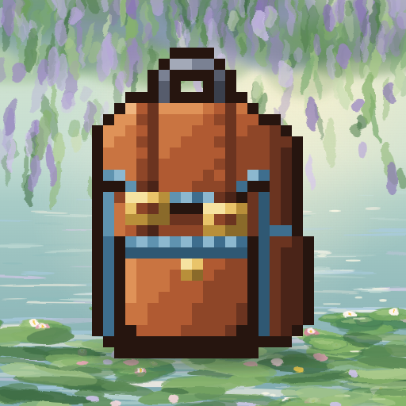
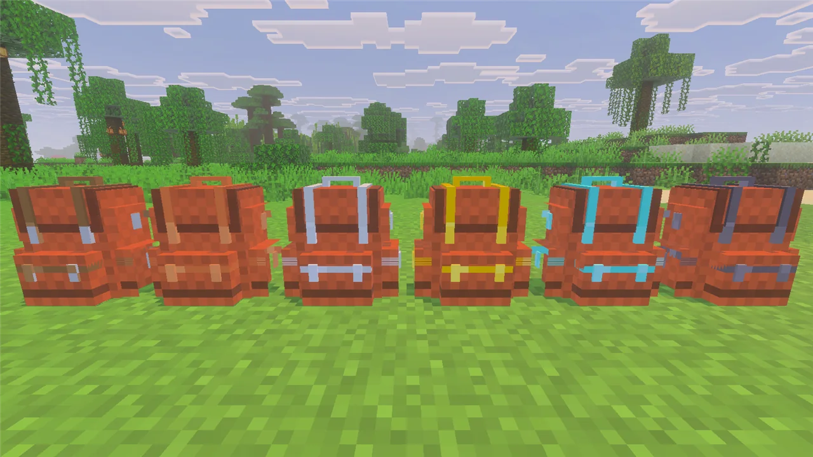
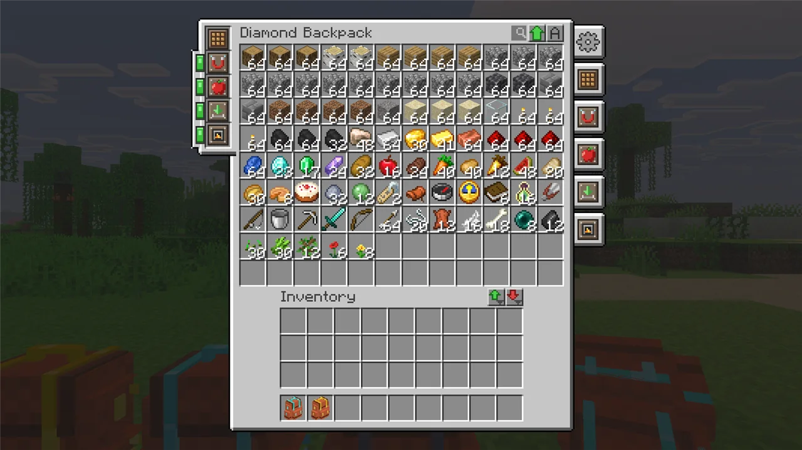
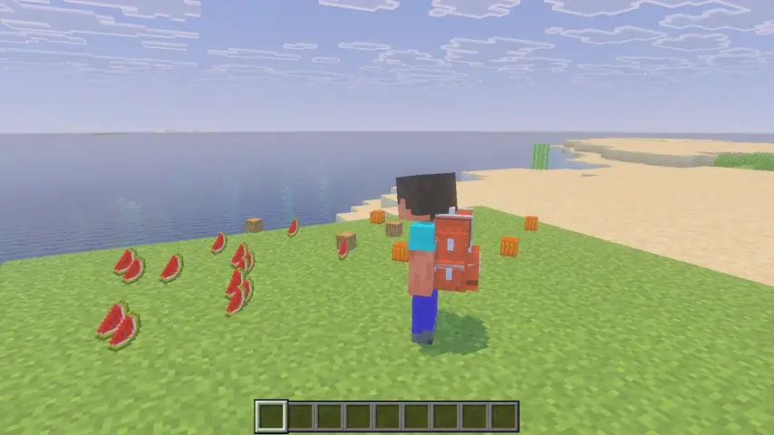
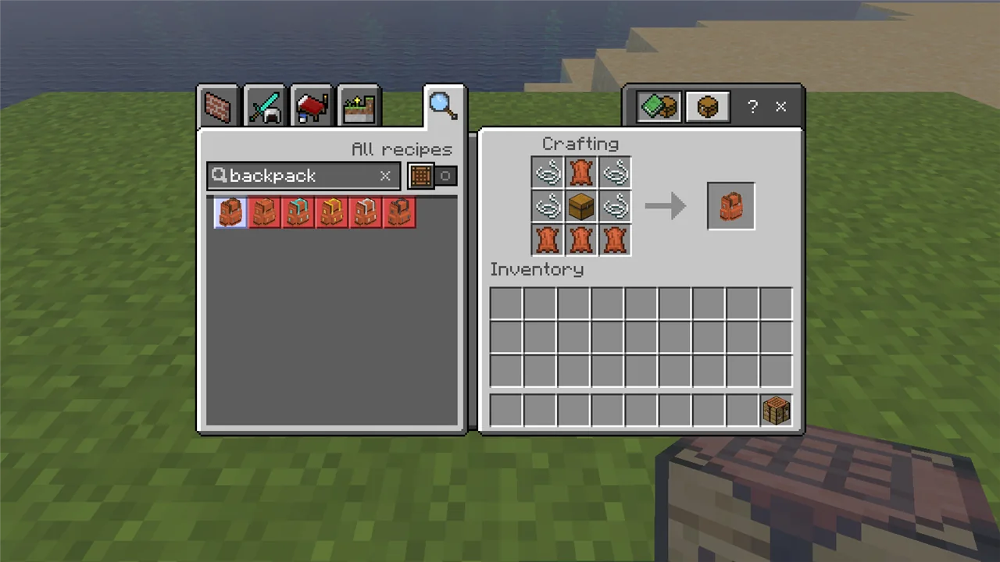

# AlleviatedBackpacks



[](https://github.com/LiteLDev/AlleviatedBackpacks/releases)
[](COPYING.LESSER)

Backpacks with upgrades for **Minecraft Bedrock Edition**: the gameplay of the Java mod
[Sophisticated Backpacks](https://www.curseforge.com/minecraft/mc-mods/sophisticated-backpacks),
in single player and on servers. Wear them, place them, fill them, and slot in upgrades that pick
up, feed, craft and sort for you.



## Features

- **Six tiers**, from Leather to Netherite. Bigger tiers hold more items and more upgrades.

  | Tier | Leather | Copper | Iron | Gold | Diamond | Netherite |
  | ---- | :-----: | :----: | :--: | :--: | :-----: | :-------: |
  | Storage slots | 27 | 45 | 54 | 81 | 108 | 120 |
  | Upgrade slots | 1 | 1 | 2 | 3 | 5 | 7 |

- **Sophisticated Backpacks' own screen**: a scroll bar, search, sorting, quick transfer buttons,
  and an upgrade column with on/off switches and a settings tab for every upgrade.

  

- **Every upgrade from the Java mod**: Pickup, Magnet, Feeding, Filter, Compacting, Void, Restock,
  Deposit, Refill, Tool Swapper, Crafting, Stonecutter, Anvil, Smithing, Smelting / Smoking /
  Blasting (and auto versions), Stack, Jukebox, Tank, Battery, Pump, XP Pump, Alchemy,
  Mob Catcher, Inception, Everlasting and Infinity. Most come in a basic and an advanced version
  with item filters. The Ender Linker links backpacks so they share their contents.

  

- **Contents belong to the backpack**: drop it, hand it to a friend, put it in a chest, place it on
  the ground. The items stay inside. Shift over a backpack to peek at what it holds.
- **Worn on your back, held, or placed** as a block, with a 3D model. Mobs sometimes spawn wearing
  backpacks, and dungeon chests can hold backpacks and upgrades.
- In-game text in English and Simplified Chinese; each player sees their own game language.

## Install

Players need the **client** mod to open backpacks, in single player and on a server. A server
needs the **server** mod. Use the same version on both.

With [lip](https://github.com/LiteLDev/lip):

```sh
lip install github.com/LiteLDev/AlleviatedBackpacks#client   # players: in the game folder
lip install github.com/LiteLDev/AlleviatedBackpacks          # servers: in the server folder
```

Or download from the [latest release](https://github.com/LiteLDev/AlleviatedBackpacks/releases/latest):

- **Players:** `alleviatedbackpacks-client-windows-x64.zip`. In LeviLauncher, extract it so that the
  `AlleviatedBackpacks` folder lands in the game version's `mods` folder. Every local world gets the
  backpacks; nothing to switch on.
- **Servers:** `alleviatedbackpacks-server-windows-x64.zip`, extracted into the server's `plugins`
  folder. The server hands its resource pack to joining players.

Requires Minecraft Bedrock Edition **1.26.51** with LeviLamina **26.51.x** (Windows x64). Players
without the client mod can still join a server and carry backpacks, but cannot open them:
they get a download link instead of the backpack screen.

## How to use

**Crafting.** Every recipe is in the recipe book; search for "backpack" or "upgrade".



- **Leather Backpack**: chest in the middle, leather and string around it.
- **Next tier**: surround a backpack with copper / iron / gold ingots or diamonds; a Netherite
  Backpack is made at the smithing table. The contents and upgrades come along.
- **Upgrades** start from an **Upgrade Base** (string, iron, leather). Dye backpacks in a crafting
  table.

**Opening.** Right-click with a backpack in hand, press **B** to open the one you carry or wear, or
right-click a placed backpack. Sneak + right-click places a backpack; sneak + right-click with an
empty hand picks it up again. Put an upgrade into one of the slots on the left of the screen and
click its tab on the right to set it up.

| Key (Settings > Keyboard & Mouse) | Default | What it does |
| --------------------------------- | ------- | ------------ |
| Open Backpack | `B` | open the backpack you carry or wear (also over a backpack in any inventory) |
| Inventory Interaction | `C` | deposit into / restock from the container you look at |
| Toggle Upgrade 1 / 2 | `Alt+Z` / `Alt+X` | switch the first / second upgrade on or off (3–5 unbound) |
| Tool Swap | unbound | swap to the right tool (Tool Swapper upgrade) |
| Sort | middle mouse | sort the backpack |
| Transfer to Storage / Inventory | `[` / `]` | move items into / out of the backpack (Shift: everything) |

Commands: `/backpack open` opens the backpack in your hand; `/backpack info` shows its tier and
upgrades.

## Settings

The config files are in the mod's `config` folder (`mods/AlleviatedBackpacks/config/` in the game,
`plugins/AlleviatedBackpacks/config/` on a server), created on first start. `/backpack reload`
applies changes.

- `general.json`: `allowNesting` (backpacks in backpacks without the Inception upgrade),
  `allowShulkerBoxes`, `usePlayerLocale` (messages in each player's language).
- `sophisticatedbackpacks-server.json`: the Java mod's own settings with the same names, such as
  slot counts per tier, disallowed items and whether players may open other players' backpacks.
- `<upgrade>.json`: each upgrade's ranges, filter slots and speeds (for example `magnet.json`).
- `client_gui.json` (game only): `sortButtonsPosition`, `playButtonSound`.

Running a server? Every command and config key is listed in [docs/ADMIN.md](docs/ADMIN.md).

## More

More screenshots and videos: https://levimc.org/mods/github.com/LiteLDev/AlleviatedBackpacks/?tab=gallery

Building it yourself, or writing a mod against its energy and fluid API? See
[CONTRIBUTING.md](CONTRIBUTING.md).

Inspired by Sophisticated Backpacks by P3pp3rF1y. This is an independent implementation for
Bedrock, not affiliated with Mojang Studios, Microsoft or the Sophisticated Backpacks project.

## License

[LGPL-3.0-or-later](COPYING.LESSER) © LeviMC
